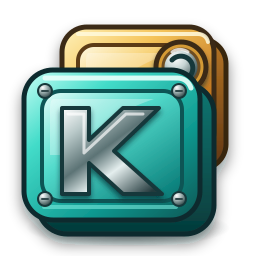

# Kache

<p align="center">
  
</p>

[English](README.md)

Kache 是面向 Dart 和 Flutter 的类型安全 stale-while-revalidate 缓存库。它能先
展示上一次可用数据，在后台刷新；刷新失败时保留旧数据，并把完整操作状态交给 UI
或任意状态管理层处理。

核心包没有第三方运行时依赖。持久化、Flutter 和状态管理接入分别位于独立包中。

## 包结构

| 包 | 用途 | 运行时边界 |
| --- | --- | --- |
| `kache` | 缓存状态机、并发、策略、内存后端 | 仅 Dart SDK |
| `kache_flutter` | Scope、Controller、Builder、Listener、应用生命周期 | Flutter + `kache` |
| `kache_flutter_hooks` | `useKache` controller 生命周期绑定 | Flutter Hooks + `kache_flutter` |
| `kache_hive_ce` | Hive CE TypeAdapter/native record、codec、迁移 | Hive CE + `kache` |
| `kache_connectivity_plus` | 自动网络恢复重验 | connectivity_plus + `kache` |
| `kache_riverpod` | provider/family/auto-dispose notifier 接入 | Riverpod + `kache` |
| `kache_hooks_riverpod` | 已有 Kache provider 的 `useKacheProvider` | Hooks Riverpod + `kache_riverpod` |
| `kache_bloc` | `KacheCubit` 与可组合 binding | Bloc + `kache` |
| `kache_provider` | Provider 组件与 context helper | Provider + `kache_flutter` |

应用通常只声明一个最上层 Kache 接入包。只有源码直接 import 更底层能力时才额外
声明，例如持久化使用 `kache_hive_ce`，Bloc UI 使用 `flutter_bloc`。

## 快速开始

```bash
flutter pub add kache_flutter
```

声明数据如何获取，在应用边界提供一个 client，然后根据 snapshot 构建页面。默认策略会
立即显示可用缓存，同时在后台重新请求最新数据。

```dart
import 'package:flutter/material.dart';
import 'package:kache_flutter/kache_flutter.dart';

typedef Profile = ({String name});

Widget createProfileApp({required Future<Profile> Function() fetchProfile}) =>
    KacheScope(
      client: KacheClient(),
      ownership: KacheScopeOwnership.owned,
      child: MaterialApp(
        home: Scaffold(
          body: KacheBuilder<Profile>(
            query: KacheQuery<Profile>.memory(
              key: KacheKey('profile'),
              fetch: (_) => fetchProfile(),
            ),
            builder: (context, snapshot, controller) => snapshot.when(
              idle: () => const SizedBox.shrink(),
              loading: () => const Center(child: CircularProgressIndicator()),
              failed: (_) => Center(
                child: FilledButton(
                  onPressed: controller.load,
                  child: const Text('Try again'),
                ),
              ),
              ready: (profile) => _profileList(
                profile,
                controller,
                refreshing: snapshot.isRefreshing,
              ),
              refreshError: (profile, _) =>
                  _profileList(profile, controller, refreshFailed: true),
            ),
          ),
        ),
      ),
    );

Widget _profileList(
  Profile profile,
  KacheController<Profile> controller, {
  bool refreshing = false,
  bool refreshFailed = false,
}) => RefreshIndicator(
  onRefresh: () async => controller.refresh(),
  child: ListView(
    physics: const AlwaysScrollableScrollPhysics(),
    children: <Widget>[
      ListTile(
        title: Text(profile.name),
        subtitle: refreshFailed
            ? const Text('Refresh failed - showing cached data')
            : null,
        trailing: refreshing
            ? const CircularProgressIndicator()
            : const Icon(Icons.cloud_done),
      ),
    ],
  ),
);
```

`KacheBuilder` 会自动加载。`when` 完整处理 idle、首次 loading、无数据失败、ready
数据以及保留旧数据的刷新失败。刷新中默认继续进入 `ready`；只有确实需要用 loading
替换数据界面时才设置 `skipLoadingOnRefresh: false`。下拉刷新仍复用同一个 query 和
请求去重机制。

`KacheQuery.memory` 会在 client 生命周期内保留数据。需要跨应用重启恢复时，使用
`KacheQuery.persisted` 和 `kache_hive_ce`。

## 纯 Dart 使用

纯 Dart 应用可以只依赖无第三方运行时依赖的 `kache`，直接使用 resource stream。
所有权和清理方式请参考[核心包快速开始](packages/kache/README.zh-CN.md#快速开始)。

## Hooks

Flutter Hooks 用户添加 `kache_flutter_hooks` 后可直接写
`final cache = useKache(query)`。Hook 会解析 `KacheScope`，返回普通
`KacheController`，根据 `cache.snapshot` 重建，并自动释放 controller。

Hooks Riverpod 用户先定义普通 `kacheProvider`，再调用
`useKacheProvider(ref, provider)`。Riverpod 仍是唯一 resource owner，因此 family、
override、auto-dispose、keep-alive、observer 和 scope 都保持原生行为。两个适配包都
不会增加第二套缓存状态模型。

## 策略选择

| 需求 | 策略 |
| --- | --- |
| 先显示缓存，并在加载/恢复时刷新 | `KachePolicy.staleWhileRevalidate()` |
| 新鲜期内避免重复请求 | `KachePolicy.cacheFirst(freshFor: ...)` |
| 永不自动请求 | `KachePolicy.cacheOnly()` |
| 每次请求且完全不缓存 | `KacheQuery.networkOnly(...)` |

`staleAfter` 决定数据何时变旧；`expireAfter` 是硬过期边界，超过后数据会被删除而不是
发出；`gcAfter` 控制无人引用的内存条目保留时长。

设置 `refreshInterval` 后，只在 resource handle 已 load 且仍活动时轮询；同 key 请求仍会
自动合并。`pausePolling()` 和 `resumePolling()` 只控制计时器，不会禁用手动缓存命令。
`KacheQuery.networkOnly` 接受同名周期，但不会因此启用缓存。

## 网络恢复

核心接受任意 `KacheNetwork` 实现，并继续保持仅依赖 Dart SDK。配置的来源从
`unavailable` 变为 `available` 时，每个活动 handle 独立应用自己的
`refreshOnReconnect` 策略；重验保持 single-flight，最多合并一次尾随执行。

Flutter 应用可使用官方 `kache_connectivity_plus` 适配包。网络接口可用只是重试信号，
不代表 Internet 或目标服务一定可达。来源错误会作为 connectivity 事件报告，不会
丢弃缓存数据。

## 持久化

`KacheClient()` 默认只使用内存。需要跨重启恢复时，为客户端配置
`KachePersistenceBackend`，并通过后端创建的 binding 声明 persisted query。官方
实现是 `kache_hive_ce`。

序列化不属于核心包。存储适配器负责 codec、物理记录、schema 版本、迁移、加密配置
和损坏恢复；核心只处理类型化数据和缓存元数据。`kache_hive_ce` 可以通过
`store.bindAdapter<T>(adapter)` 复用已注册的 `TypeAdapter<T>`，也可以使用显式 byte
codec binding 获得独立 schema 控制。

## 自定义持久层

可以为 SQLite、Isar、文件、安全存储或其他系统实现 `KachePersistenceBackend`。
实现必须：

- 返回类型化 `KachePersistenceRead<T>`；
- 校验 binding 属于当前 backend；
- 完整保存 `KachePersistedMetadata`；
- 按规范 namespace prefix 精确清理；
- 用 `KachePersistenceException` 包装 I/O 和 codec 失败；
- 每个包装异常报告实际发生的 persistence operation；
- 明确定义幂等所有权与 `close()` 语义。

核心会在边界校验 operation 字段。backend 标记错误 operation 时，核心按实际运行的
操作归类为 backend 失败，同时保留原始异常和堆栈。

可参考 `MemoryKachePersistence` 和持久层契约测试。不要把 codec 方法加入
`KacheQuery` 或核心持久化协议。

## 错误处理

快照把失败作为状态数据携带，stream 不会用 `addError` 表达预期的请求或持久化
失败。`KacheFailure` 保留原始异常和堆栈，但 `toString()` 会脱敏。命令式代码可调用
`snapshot.throwIfFailed()` 或 `clearResult.throwIfFailed()`。

日志和遥测可以订阅 `KacheClient.events` 或注入 observer。这个通道是受信任的进程内
领域事件，而不是预先脱敏的日志 DTO：成功的缓存命中、
读取、请求、写入和 set 事件可以通过 `hasData`、`dataOrNull` 与
`requireData<T>()` 访问原始对象；应用也可以读取 query key 和不可变 metadata 做路由。
Kache 不会自动打印或上传事件，`KacheEvent.toString()` 始终省略 data、key、metadata、
异常 cause 和堆栈。订阅者使用标准 stream operator 自行决定筛选、映射、脱敏、打印
和上传。`kind`、`phase`、`trigger` 描述操作，`traceId`、`id`、`parentId` 关联 span，
`clientId` 与 `sequence` 保留单个 client 内的顺序。

订阅时只选择需要的事件，再交给应用自己的脱敏/上报边界：

```dart
import 'dart:async';

import 'package:kache/kache.dart';

StreamSubscription<KacheEvent> watchFailures(
  KacheClient client,
  void Function(KacheEvent event) report,
) => client.events
    .where(
      (event) =>
          event.phase == KacheEventPhase.failed ||
          event.phase == KacheEventPhase.cancelled,
    )
    .listen(report);
```

持有返回的 subscription，并随其 owner 一起取消。默认传递 `event.toString()` 不会
泄露敏感内容；读取 `dataOrNull`、`key` 或 `metadata` 是应用的显式选择，必须自行脱敏。

## 取消

`resource.cancel()` 取消当前 key 正在执行的共享 fetch；没有 handle 时可以调用
`client.cancel(key)`，`client.cancelAll()` 返回实际取消的 key 数。因为同 key 调用者
共享 single-flight，请求取消会影响该 key 的所有等待者，但不会删除缓存、释放 handle
或禁止后续轮询。

即使 fetcher 返回无法物理中止的 Future，逻辑取消也会立即恢复可见快照，并永久隔离
迟到的 value/error。Fetcher 可把 `context.cancellation.whenCancelled` 桥接到 HTTP
客户端的 cancel token 或 abort controller，并在 await 后调用
`context.throwIfCancelled()` 完成协作式物理取消。set、invalidate、remove、clear、close
自动取代请求时会分别报告 `dataSet`、`invalidate`、`remove`、`clear`、`close` 原因。

Dio 接入时，每次 fetch 创建一个 token，并在请求边界桥接取消：

```dart
import 'dart:async';

import 'package:dio/dio.dart';
import 'package:kache/kache.dart';

Future<T> withDioCancellation<T>(
  KacheFetchContext context,
  Future<T> Function(CancelToken token) request,
) async {
  final token = CancelToken();
  unawaited(context.cancellation.whenCancelled.then(token.cancel));

  try {
    final value = await request(token);
    context.throwIfCancelled();
    return value;
  } on DioException catch (error) {
    if (CancelToken.isCancel(error) && context.isCancelled) {
      context.throwIfCancelled();
    }
    rethrow;
  }
}
```

在 query 的 `fetch` 内调用这个 helper，并把 token 传给 Dio 的 `cancelToken` 参数。
Dio token 取消后不能复用，因此每次 fetch 都必须创建新 token。

## 生命周期

每次 `client.watch(query)` 都返回独立的 `KacheResource` handle。取消 stream 监听不
等于释放资源，必须调用 `resource.dispose()`；应用边界再关闭 client 和 owned backend。

Flutter 应用应使用 `KacheScope`，由它选择是否拥有 client，在离开前台时暂停轮询，
并在恢复前台时自动重验活跃资源；reconnect 重验也会在后台延后，并在恢复后只消费
一次待处理恢复。状态管理适配器拥有自己的 resource handle，但不会拥有传入的 client。

## 兼容性

每个发布包独立声明并验证最低 SDK，不继承 monorepo 开发工具使用的较新版本。

| 包 | Dart | Flutter |
| --- | --- | --- |
| `kache` | >=3.5.0 <4.0.0 | 不需要 |
| `kache_flutter` | >=3.5.0 <4.0.0 | >=3.24.0 |
| `kache_flutter_hooks` | >=3.8.0 <4.0.0 | >=3.32.0 |
| `kache_hive_ce` | >=3.5.0 <4.0.0 | 不需要 |
| `kache_riverpod` | >=3.7.0 <4.0.0 | 不需要 |
| `kache_hooks_riverpod` | >=3.8.0 <4.0.0 | >=3.32.0 |
| `kache_bloc` | >=3.5.0 <4.0.0 | 不需要 |
| `kache_connectivity_plus` | >=3.5.0 <4.0.0 | >=3.24.0 |
| `kache_provider` | >=3.5.0 <4.0.0 | >=3.24.0 |

官方适配包支持 Hive CE `>=2.19.3 <3.0.0`、connectivity_plus
`>=7.3.0 <8.0.0`、Riverpod `>=3.3.2 <4.0.0`、Flutter Hooks
`>=0.21.3+1 <0.22.0`、Hooks Riverpod `>=3.3.2 <4.0.0`、Bloc
`>=9.2.1 <10.0.0` 和 Provider `>=6.1.5+1 <7.0.0`。
当前 stable 工作区实际验证 Riverpod/Hooks Riverpod 3.4.2 与 connectivity_plus 7.3.1，
同时保留可由旧 SDK 解析的兼容下限。

## 示例

`examples/` 提供 Flutter Hooks、Hooks Riverpod、Bloc/Cubit 和 Provider 四个可运行应用。
它们使用真实 GitHub repository API、Hive CE 和网络恢复适配器，覆盖冷启动、重启
缓存首显、刷新、网络恢复重验、失败保留旧数据和清缓存。

## 许可证

Kache 使用 MIT License。
